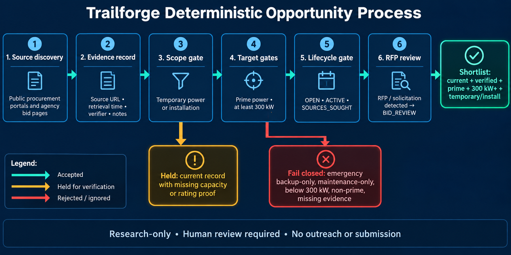

# Current opportunity workflow

Trailforge separates opportunity discovery from verified current lead output.



## Qualification gates

`current_target_fixtures` places a record on the current shortlist only when the
fixture is source-verified and current (`OPEN`, `ACTIVE`, or `SOURCES_SOUGHT`)
and `screen_aura_rental_candidate` returns `QUALIFIED`.

That screen requires all of the following:

1. Planned temporary, construction, commissioning, energization, startup, or
   bridge-power scope, including grid or utility delay.
2. An explicitly captured requirement of at least 300 kW. Equipment ratings,
   parent-facility nameplate, and program aggregates do not satisfy this gate.
3. Captured natural-gas or propane compatibility (`natural gas`, `cng`,
   `propane`, or `lpg`).

Emergency or contingency scope, permanent capacity or PPA structures,
maintenance-only work, diesel or light fuel oil, and a requirement below 300 kW
are rejected. Missing planned scope, requirement, or fuel stays `NEEDS_REVIEW`
and off the shortlist.

## Running results

```text
uv run --python 3.11 python -m athena_procurement_arena shortlist --bundle path/to/bundle.json
```

The output is JSON with `status`, `count`, and compact provenance-bearing
`fixtures`. A zero count means no record in that bundle passed every gate; it does
not mean the broader market has no opportunities.

## Current research checkpoint

As of 2026-09-08, the checked-in source-backed generator records are historical or
otherwise non-current. PSEG Long Island/LIPA's 2026 Temporary Generation RFP is a
promising held candidate, but its public listing does not verify a per-project
minimum capacity or prime rating. See
`research/current-opportunity-screen-2026-09-08.md` and
`.agent/artifacts/current-opportunity-screen-015/SCREEN.json`.

## Boundaries

This workflow does not perform live scraping, source verification on the user's
behalf, vendor outreach, bid preparation, response submission, award prediction,
or generator maintenance services. It preserves source URLs, retrieval times,
verification notes, and lifecycle status for human review.
